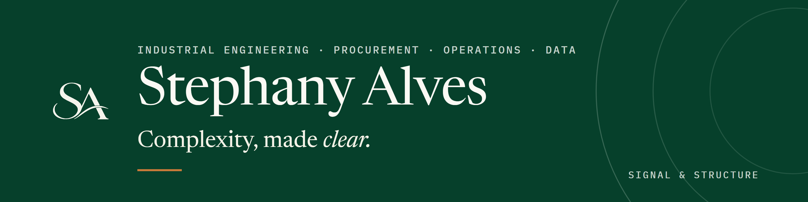
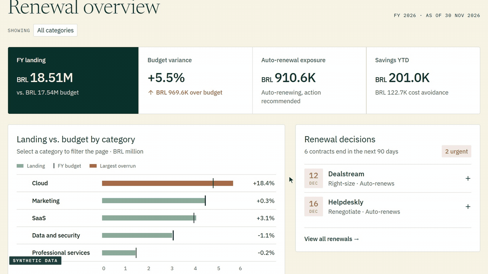
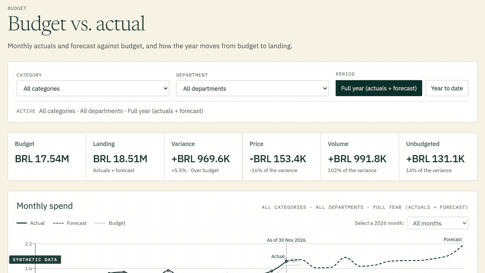
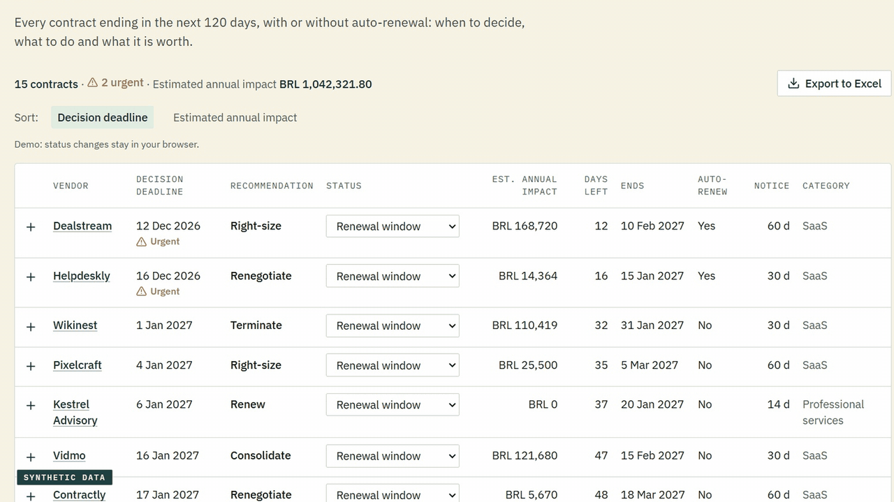
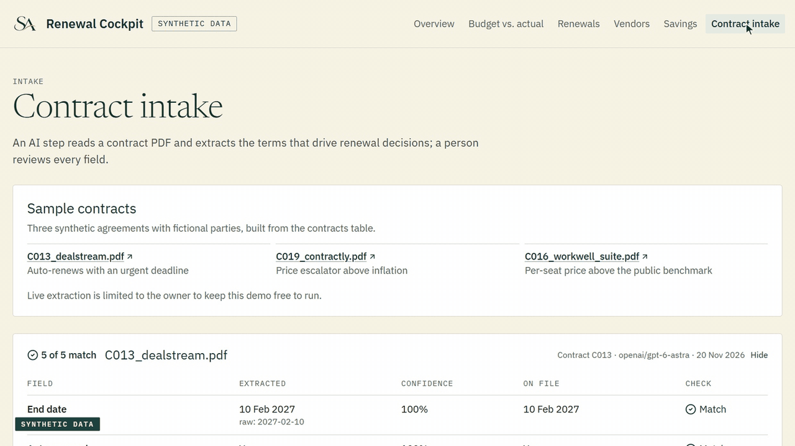
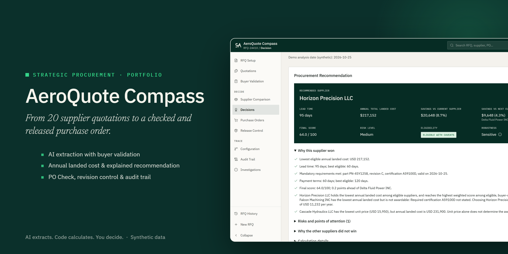
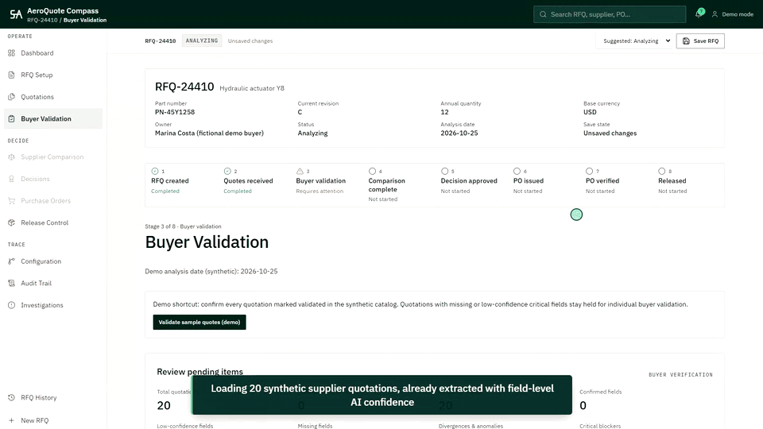
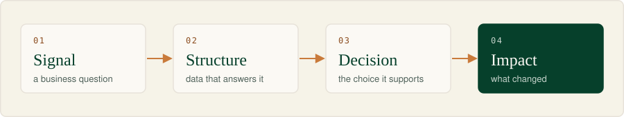
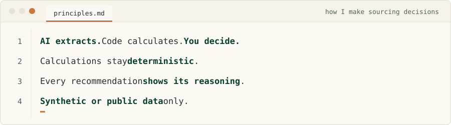
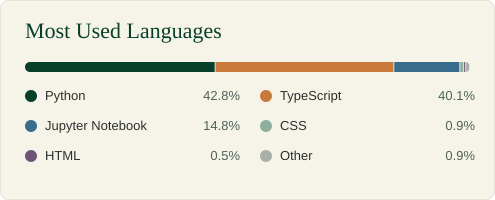

  

  <code>Procurement & Supply Chain</code> · <code>Industrial Engineer</code> · <code>Data and AI for sourcing decisions</code>

  
  
  
  
  
  
  
  
  
  
  <!-- The counter only counts requests made through GitHub's image proxy, so this 1px copy is what records each visit; the badge above only displays the number. -->
  

  I work where procurement, engineering and data meet: structuring complex supplier information 
  so that sourcing decisions can be made on evidence, and their impact can be measured.

  Industrial engineer with about four years in aerospace procurement and supplier management. 
  I build portfolio projects that turn real sourcing problems into working tools, using synthetic data only.

<table align="center">
  <tr>
    <td align="center" width="220">
      <h3>🏭 200+</h3>
      suppliers managed in aerospace direct materials
    </td>
    <td align="center" width="220">
      <h3>💰 Six-figure (USD)</h3>
      savings on strategic items, validated by Finance
    </td>
    <td align="center" width="220">
      <h3>⚡ 97%</h3>
      less effort in supplier due diligence renewals, through a Kaizen
    </td>
  </tr>
</table>

### 01 · 🌱 Right now

- 🔭 **Building:** AeroQuote Compass and a should-cost model for wire harnesses and connectors
- 📚 **Learning:** SQL, Python, Tableau and Databricks, through the portfolio projects below
- 💬 **Ask me about:** should-cost, strategic sourcing, procurement, supplier quality, maintenance engineering, vendor management and procurement analytics
- 🤝 **Open to:** Senior Procurement Analyst · Procurement Analyst · Strategic Sourcing Analyst · Supplier Quality Engineer · Data Analyst
- 📍 **Availability:** Belo Horizonte, Brazil (UTC−3) · remote, hybrid or on-site · available immediately · [📅 Book a 30-min call](https://calendar.app.google/y34oLpDbrQeJnDhh9)
- 🗣️ **Languages:** Brazilian Portuguese (native) · English (fluent) · Spanish (fluent)
- ⚡ **Fun fact:** I can't look at a cable anymore without estimating its should-cost, copper price included.
- 📖 **Outside work:** reading

### 02 · 🧾 Featured project: Vendor Spend & Renewal Cockpit 

  
  

    Budget and contract-renewal cockpit for the indirect-procurement team of a fictional fintech (BRL 18.5M third-party spend). 
    It answers the three questions a procurement lead gets every month: <b>will we land the year on budget</b>, 
    <b>which contracts need a decision before they auto-renew</b>, and <b>where can we cut or consolidate spend</b>.
  

<table>
  <tr>
    <td align="center" width="33%"><h3>+5.5% over budget</h3>and it is volume, not price: cloud usage grows 3.5%/month against 2% planned</td>
    <td align="center" width="33%"><h3>BRL 1.04M / year</h3>from acting on 15 contracts that renew within 120 days, more than the whole overrun</td>
    <td align="center" width="33%"><h3>2 urgent decisions</h3>decision deadlines in December; both contracts auto-renew if nobody acts</td>
  </tr>
</table>

<table>
  <tr>
    <td width="50%"></td>
    <td width="50%"></td>
  </tr>
  <tr>
    <td align="center"><b>Budget vs. actual</b> budget to landing, split into price, volume and unbudgeted spend</td>
    <td align="center"><b>Renewals</b> decision deadline, recommendation and the rule behind it</td>
  </tr>
</table>

  
<b>▶ AI contract intake</b> an AI step extracts five renewal terms from a contract PDF, each checked field by field against the contract on file

   
  

  

    <code>Synthetic spend and contracts</code> → <code>Python: forecast, variance split, renewal rules (tested)</code> → <code>Supabase views (row level security)</code> → <code>Web app</code> + <code>weekly alert e-mail</code>
  

  

    <b>Stack:</b> <code>Python</code> <code>pandas</code> <code>pytest</code> <code>SQL</code> <code>Supabase</code> <code>TypeScript</code> <code>React</code> <code>TanStack Start</code> <code>Recharts</code> <code>Lovable</code>
  

  
  
  

### 03 · 🚀 Featured project: AeroQuote Compass 

  
  

    Aerospace procurement workspace that takes supplier quotations <b>from RFQ to a released purchase order</b>. 
    AI extracts quotes into a fixed schema, the buyer confirms every critical field, and deterministic code computes 
    annual landed cost, eligibility and an explained recommendation. The PO is then checked against the approved decision, 
    revision-gated and released, with an exportable audit trail (PDF, Excel, CSV).
  

  

    <code>RFQ</code> → <code>AI extraction</code> → <code>Buyer validation</code> → <code>Landed cost & eligibility</code> → <code>Explained recommendation</code> → <code>PO Check</code> → <code>Release</code>
  

  

    <b>Stack:</b> <code>TypeScript</code> <code>React 19</code> <code>TanStack Start</code> <code>Tailwind CSS</code> <code>Supabase</code> <code>Vitest</code> <code>Playwright</code> <code>Lovable</code>
  

  

    
<b>▶ Watch it work</b> 20 quotations from buyer validation to an explained recommendation (19 s)

     
    
  

   
  
  

### 04 · 🧭 Selected work

| Project | What it shows | Stack | Status |
|---|---|---|---|
| **Procurement market briefs** | Six one-page decision briefs for procurement (aerospace supply market, Brazil EV supply chain, procurement performance, supplier quality, Six Sigma and non-conformance), rebuilt every month from Comex Stat, BLS PPI and BCB PTAX data, in English and Portuguese, by a GitHub Actions workflow. | `Python` `pandas` `Matplotlib` `Playwright` `GitHub Actions` |  [Repo](https://github.com/stephanyalves-eng/procurement-market-briefs) · [Editions](https://github.com/stephanyalves-eng/procurement-market-briefs/tree/main/editions) |
| **Procurement analytics with SQL and Python** | Spend concentration (Pareto, HHI), seller dispatch SLA and a weighted supplier scorecard on 99k public Olist orders. 17.7% of sellers hold 80% of spend; measuring at delivery hides 78.8% of late dispatches; a 633-seller scorecard narrows action to 60 priority sellers. | `SQL` `DuckDB` `Python` `pandas` `Plotly` `pytest` |  [Repo](https://github.com/stephanyalves-eng/procurement-analytics-olist) · [Summary (PDF)](https://github.com/stephanyalves-eng/procurement-analytics-olist/blob/main/reports/executive_summary.pdf) · [Kaggle](https://www.kaggle.com/code/stephanyalveseng/procurement-lens-on-olist-supplier-scorecard) |
| **Brazilian mining performance and market concentration** | SQL-first analysis of ANM open data (2010–2025, 2.43M CFEM royalty rows): price vs volume, commodity and state mix, and HHI concentration. Iron ore's share fell from 75.8% to 56.7%, VALE pays 70.6% of iron ore royalties, and a duplicate export in the Feb 2024 file would overstate 2024 growth (12.8% instead of 8.4%). 117 tests. | `SQL` `DuckDB` `Python` `pytest` `Tableau` |  [Repo](https://github.com/stephanyalves-eng/brazil-resources-intelligence/tree/main/mining-intelligence) · [Dashboard](https://public.tableau.com/app/profile/stephany.alves/viz/Brazilian_Mining_Performance/1ExecutiveOverview) |
| **Brazilian oil and gas production analytics** | Python pipeline on ANP monthly production (1997–2026): growth regimes, regional concentration, stability and gas use. 97.6% of oil is offshore, more than half of the gas is now reinjected (54.4% in 2025) and flaring fell from 17.9% to 2.8%. 90 tests. | `Python` `pandas` `NumPy` `Matplotlib` `pytest` `Tableau` |  [Repo](https://github.com/stephanyalves-eng/brazil-resources-intelligence/tree/main/oil-gas-intelligence) · [Dashboard](https://public.tableau.com/app/profile/stephany.alves/viz/Brazilian_Oil_Gas_Production/1ProductionOverview) |
| **Supplier performance dashboard in Tableau** | Supplier scorecards and delivery risk, built for decision meetings. | `Tableau` |  |
| **Wire harness and connector should-cost** | Bottom-up should-cost and category strategy for wire harnesses and connectors, calibrated on Comex Stat import prices, with a copper price-adjustment clause backtested for both buyer and supplier. | `Python` `Comex Stat` `Should-cost` |  [Repo](https://github.com/stephanyalves-eng/p1-wire-harness-should-cost) |
| **Field failure intelligence and crimping SPC** | Links field failure modes from NHTSA and FAA data to crimp height control, with SPC charts, Cpk, Gage R&R, an 8D on a real recall and an AIAG-VDA PFMEA. | `Python` `SPC` `PFMEA` `8D` |  [Repo](https://github.com/stephanyalves-eng/p2-field-failure-spc) |
| **Assembly line simulation for rate ramp-up** | Discrete-event simulation of a subassembly line moving from 42 to 47 aircraft per month, comparing line improvements by cost per additional unit. | `Python` `Discrete-event simulation` |  [Repo](https://github.com/stephanyalves-eng/p3-assembly-line-simulation) |
| **Mine-to-port planning and fleet reliability** | Linear programming model of a mine, rail and port network that maximizes margin within iron grade limits, uses shadow prices to rank bottlenecks and adds Weibull-based fleet availability. | `Python` `Linear programming` `Weibull` |  [Repo](https://github.com/stephanyalves-eng/p4-mine-to-port-planning) |

<b>Latest edition of the market briefs</b> Rebuilt automatically on the 16th of every month. These previews update by themselves.

  
  
  

### 05 · ✍️ Latest writing

<!-- The list below is refreshed daily from the Medium and DEV feeds by .github/workflows/latest-writing.yml -->
<!-- BLOG-POST-LIST:START -->
- [Which contracts renew before anyone decides?](https://medium.com/@stephany.alves/which-contracts-renew-before-anyone-decides-18a069556286?source=rss-47b95d0f4e54------2) · Nov 21, 2026
- [I automated the monthly market brief I always wanted as an aerospace buyer.](https://dev.to/stephanyalves/i-automated-the-monthly-market-brief-i-always-wanted-as-an-aerospace-buyer-28hh) · Nov 11, 2026
- [The Cheapest Quote Was the Most Expensive One](https://medium.com/@stephany.alves/the-cheapest-quote-was-the-most-expensive-one-d92bfcbec030?source=rss-47b95d0f4e54------2) · Nov 9, 2026
- [Savings at 104% of target. Net of price increases, 61%.](https://medium.com/@stephany.alves/savings-at-104-of-target-net-of-price-increases-61-953a6827a392?source=rss-47b95d0f4e54------2) · Nov 3, 2026<!-- BLOG-POST-LIST:END -->

More on [Medium](https://medium.com/@stephany.alves) and [DEV](https://dev.to/stephanyalves).

### 06 · ⚙️ How I work

Every project starts from a business question, organizes the data that answers it, shows the decision it supports and states what changed. AI handles the repetitive work; calculations stay deterministic and every recommendation shows its reasoning.

### 07 · 🎯 Capabilities

| Area | What I do |
|---|---|
| **Strategic sourcing** | RFQs, should-cost, adding qualified sources to single-source parts, negotiation backed by evidence, supplier due diligence |
| **Supplier quality** | Supplier qualification, PPAP, 8D, SPC and Cpk, PFMEA |
| **Procurement analytics** | Spend, savings, on-time delivery and supplier scorecards in Power BI, SQL and Python |
| **Continuous improvement** | Lean, Kaizen, A3, Ishikawa, 5 Whys |

### 08 · 🧰 Toolkit

**Procurement**

**Data**

SQL, Python, Tableau and Databricks: building portfolio projects now.

**Product and AI**

**Process**

<b>📊 GitHub stats and activity</b> (click to expand)

 

  
  <!-- Rebuilt daily by .github/workflows/languages-card.yml with colors from the profile palette -->
  
    
  

**⚡ Recent activity**

<!-- The list below is refreshed daily by .github/workflows/recent-activity.yml -->
<!--START_SECTION:activity-->
1. 🔨 [brazil-resources-intelligence](https://github.com/stephanyalves-eng/brazil-resources-intelligence): [Tableau dashboards: cards and charts follow every click](https://github.com/stephanyalves-eng/brazil-resources-intelligence/commit/90f2110b5d685e7f23f863da81340ec7ca032d7c) · Nov 21, 2026
2. 🔨 [renewal-cockpit](https://github.com/stephanyalves-eng/renewal-cockpit): [Replace README screenshots with GIFs of the app in use](https://github.com/stephanyalves-eng/renewal-cockpit/commit/ddcc30f823c821efd1d9ccaf7c93b1260c538236) · Nov 21, 2026
3. 🔨 [vendor-renewal-cockpit](https://github.com/stephanyalves-eng/vendor-renewal-cockpit): [Replace README screenshots with GIFs of the app in use](https://github.com/stephanyalves-eng/vendor-renewal-cockpit/commit/45787ca1b22a4be107ea7603698c4e406b9c8a6d) · Nov 21, 2026
4. 🔨 [procurement-market-briefs](https://github.com/stephanyalves-eng/procurement-market-briefs): [Restyle the one-page briefs in Stephany Alves Design System 2.0](https://github.com/stephanyalves-eng/procurement-market-briefs/commit/b4ed69d0157e42b6b03d3d247ad3298e88a4d6c3) · Nov 19, 2026
5. 🔨 [procurement-analytics-olist](https://github.com/stephanyalves-eng/procurement-analytics-olist): [Link the published Kaggle notebook](https://github.com/stephanyalves-eng/procurement-analytics-olist/commit/544136919c5f79bd220807f8541089995e788d45) · Nov 16, 2026
<!--END_SECTION:activity-->

### 09 · 🎓 Background

- Procurement analyst in aerospace direct materials (propulsion and avionics) until 2026, managing **200+ suppliers**.
- **Six-figure (USD) savings** on strategic items without purchase history, validated by Finance, partly by adding new sources to single-source parts.
- Led a Kaizen that removed **97% of the effort** in low-risk supplier due diligence renewals.
- B.Sc. in Industrial Engineering and B.B.A. (UFVJM) · Postgraduate degree in Aeronautical Maintenance Engineering (PUC Minas) · Brazilian Portuguese (native), English and Spanish (fluent).

### 10 · 📬 Contact

Belo Horizonte, Brazil · [LinkedIn](https://www.linkedin.com/in/stephany-alves) · [Himalayas](https://himalayas.app/@stephanyalves) · [Medium](https://medium.com/@stephany.alves) · [Peerlist](https://peerlist.io/stephanyalves) · [DEV](https://dev.to/stephanyalves) · [Kaggle](https://www.kaggle.com/stephanyalveseng) · [Hugging Face](https://huggingface.co/stephany-alves) · [Tableau Public](https://public.tableau.com/app/profile/stephany.alves/vizzes)

  

All public projects use synthetic or public data. No confidential company information.

 

  <i>"One machine can do the work of fifty ordinary men. No machine can do the work of one extraordinary man."</i> 
  — Elbert Hubbard

