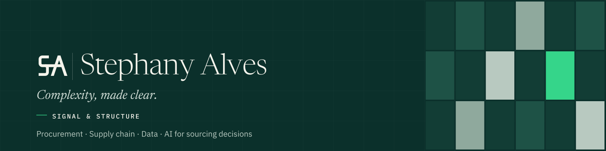
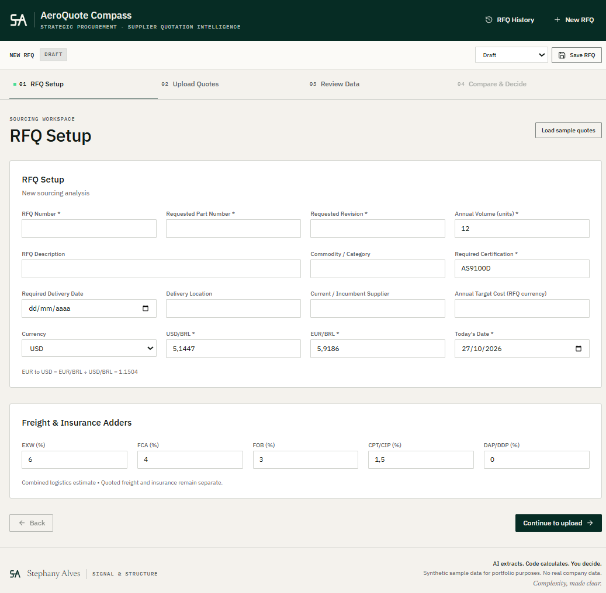
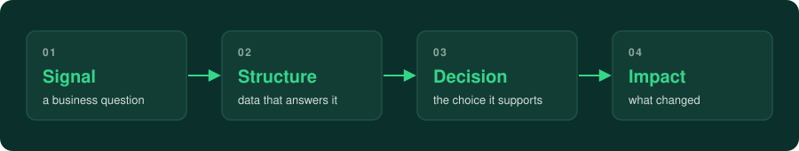

  

  <code>Procurement & Supply Chain</code> · <code>Production Engineer</code> · <code>Data and AI for sourcing decisions</code>

  
  
  
  

  I work where procurement, engineering and data meet: structuring complex supplier information 
  so that sourcing decisions can be made on evidence, and their impact can be measured.

  Production engineer with about four years in aerospace procurement and supplier management. 
  I build portfolio projects that turn real sourcing problems into working tools, using synthetic data only.

<table align="center">
  <tr>
    <td align="center" width="220">
      <h3>🏭 200+</h3>
      suppliers managed in aerospace direct materials
    </td>
    <td align="center" width="220">
      <h3>💰 USD 200k+</h3>
      savings on strategic items, validated by Finance
    </td>
    <td align="center" width="220">
      <h3>⚡ 97%</h3>
      less effort in supplier due diligence renewals, through a Kaizen
    </td>
  </tr>
</table>

### 🌱 Right now

- 🔭 **Building:** AeroQuote Compass and a should-cost model for wire harnesses and connectors
- 📚 **Learning:** SQL, Python, Tableau and Databricks, through the portfolio projects below
- 💬 **Ask me about:** should-cost, strategic sourcing, procurement, supplier quality, maintenance engineering, vendor management and procurement analytics
- 🤝 **Open to:** Senior Procurement Analyst · Procurement Analyst · Strategic Sourcing Analyst · Supplier Quality Engineer · Data Analyst
- ⚡ **Fun fact:** I can't look at a cable anymore without estimating its should-cost, copper price included.
- 📖 **Outside work:** reading

### 🚀 Featured project: AeroQuote Compass

  
  

    Supplier quotation intelligence for strategic sourcing: AI extraction with buyer review, total annual landed cost, 
    configurable supplier scoring, risk and anomaly detection, justified recommendation, PDF/Excel/CSV export. <b>78 automated tests.</b>
  

  
  

### 🧭 Selected work

| Project | What it shows | Links |
|---|---|---|
| **Procurement analytics with SQL and Python** | Spend, supplier and delivery analysis on the public Olist dataset. | In progress |
| **Supplier performance dashboard in Tableau** | Supplier scorecards and delivery risk, built for decision meetings. | In progress |
| **Wire harness and connector should-cost** | Bottom-up should-cost and category strategy for wire harnesses and connectors, calibrated on Comex Stat import prices, with a copper price-adjustment clause backtested for both buyer and supplier. | In progress · [Repo](https://github.com/stephanyalves-eng/p1-wire-harness-should-cost) |
| **Field failure intelligence and crimping SPC** | Links field failure modes from NHTSA and FAA data to crimp height control, with SPC charts, Cpk, Gage R&R, an 8D on a real recall and an AIAG-VDA PFMEA. | In progress · [Repo](https://github.com/stephanyalves-eng/p2-field-failure-spc) |
| **Assembly line simulation for rate ramp-up** | Discrete-event simulation of a subassembly line moving from 42 to 47 aircraft per month, comparing line improvements by cost per additional unit. | In progress · [Repo](https://github.com/stephanyalves-eng/p3-assembly-line-simulation) |
| **Mine-to-port planning and fleet reliability** | Linear programming model of a mine, rail and port network that maximizes margin within iron grade limits, uses shadow prices to rank bottlenecks and adds Weibull-based fleet availability. | In progress · [Repo](https://github.com/stephanyalves-eng/p4-mine-to-port-planning) |

### ⚙️ How I work

Every project starts from a business question, organizes the data that answers it, shows the decision it supports and states what changed. AI handles the repetitive work; calculations stay deterministic and every recommendation shows its reasoning.

### 🧰 Toolkit

**Procurement**

-0B302B?style=flat-square)

**Data**

SQL, Python, Tableau and Databricks: building portfolio projects now.

**Product and AI**

**Process**

<b>📊 GitHub stats and activity</b> (click to expand)

 

  
  
    
  

### 🎓 Background

- Procurement analyst in aerospace direct materials (propulsion and avionics) until 2026, managing **200+ suppliers**.
- **USD 200k+ in savings** on strategic items without purchase history, validated by Finance, partly by adding new sources to single-source parts.
- Led a Kaizen that removed **97% of the effort** in low-risk supplier due diligence renewals.
- B.Sc. in Production Engineering and B.B.A. (UFVJM) · Postgraduate degree in Aeronautical Maintenance Engineering (PUC Minas) · Fluent in English and Spanish.

### 📬 Contact

Belo Horizonte, Brazil · [LinkedIn](https://www.linkedin.com/in/stephany-alves)

All public projects use synthetic or public data. No confidential company information.

 

  <i>"One machine can do the work of fifty ordinary men. No machine can do the work of one extraordinary man."</i> 
  — Elbert Hubbard

