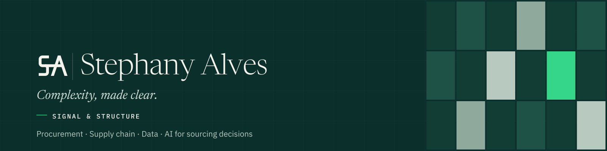
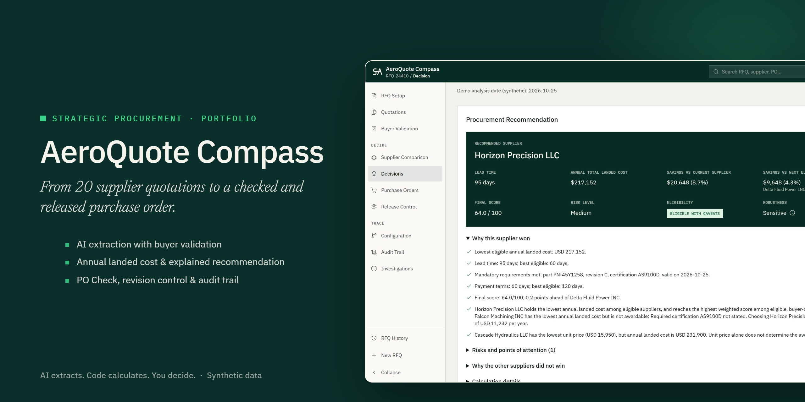
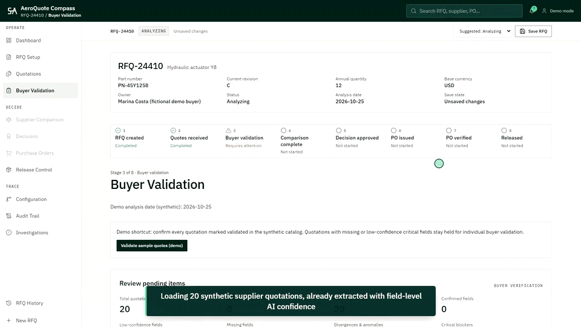
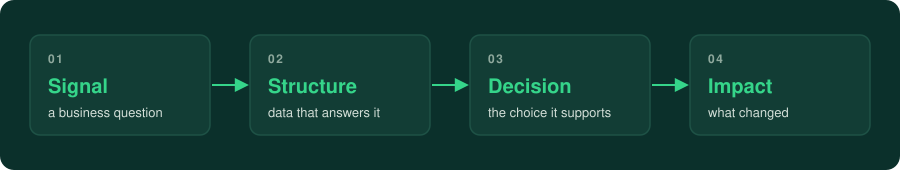
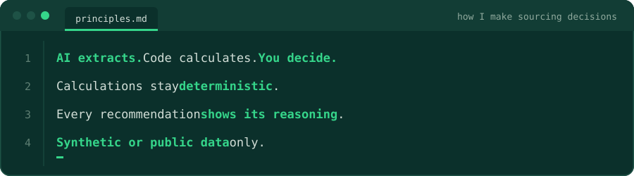

  

  <code>Procurement & Supply Chain</code> · <code>Industrial Engineer</code> · <code>Data and AI for sourcing decisions</code>

  
  
  
  
  
  
  
  
  
  <!-- The counter only counts requests made through GitHub's image proxy, so this 1px copy is what records each visit; the badge above only displays the number. -->
  

  I work where procurement, engineering and data meet: structuring complex supplier information 
  so that sourcing decisions can be made on evidence, and their impact can be measured.

  Industrial engineer with about four years in aerospace procurement and supplier management. 
  I build portfolio projects that turn real sourcing problems into working tools, using synthetic data only.

<table align="center">
  <tr>
    <td align="center" width="220">
      <h3>🏭 200+</h3>
      suppliers managed in aerospace direct materials
    </td>
    <td align="center" width="220">
      <h3>💰 Six-figure (USD)</h3>
      savings on strategic items, validated by Finance
    </td>
    <td align="center" width="220">
      <h3>⚡ 97%</h3>
      less effort in supplier due diligence renewals, through a Kaizen
    </td>
  </tr>
</table>

### 01 · 🌱 Right now

- 🔭 **Building:** AeroQuote Compass and a should-cost model for wire harnesses and connectors
- 📚 **Learning:** SQL, Python, Tableau and Databricks, through the portfolio projects below
- 💬 **Ask me about:** should-cost, strategic sourcing, procurement, supplier quality, maintenance engineering, vendor management and procurement analytics
- 🤝 **Open to:** Senior Procurement Analyst · Procurement Analyst · Strategic Sourcing Analyst · Supplier Quality Engineer · Data Analyst
- 📍 **Availability:** Belo Horizonte, Brazil (UTC−3) · remote, hybrid or on-site · available immediately · [📅 Book a 30-min call](https://calendar.app.google/y34oLpDbrQeJnDhh9)
- 🗣️ **Languages:** Brazilian Portuguese (native) · English (fluent) · Spanish (fluent)
- ⚡ **Fun fact:** I can't look at a cable anymore without estimating its should-cost, copper price included.
- 📖 **Outside work:** reading

### 02 · 🚀 Featured project: AeroQuote Compass 

  
  

    Aerospace procurement workspace that takes supplier quotations <b>from RFQ to a released purchase order</b>. 
    AI extracts quotes into a fixed schema, the buyer confirms every critical field, and deterministic code computes 
    annual landed cost, eligibility and an explained recommendation. The PO is then checked against the approved decision, 
    revision-gated and released, with an exportable audit trail (PDF, Excel, CSV).
  

  

    <code>RFQ</code> → <code>AI extraction</code> → <code>Buyer validation</code> → <code>Landed cost & eligibility</code> → <code>Explained recommendation</code> → <code>PO Check</code> → <code>Release</code>
  

  

    <b>Stack:</b> <code>TypeScript</code> <code>React 19</code> <code>TanStack Start</code> <code>Tailwind CSS</code> <code>Supabase</code> <code>Vitest</code> <code>Playwright</code> <code>Lovable</code>
  

  

    
<b>▶ Watch it work</b> 20 quotations from buyer validation to an explained recommendation (19 s)

     
    
  

   
  
  

### 03 · 🧭 Selected work

| Project | What it shows | Stack | Status |
|---|---|---|---|
| **Procurement market briefs** | Six one-page decision briefs for procurement (aerospace supply market, Brazil EV supply chain, procurement performance, supplier quality, Six Sigma and non-conformance), rebuilt every month from Comex Stat, BLS PPI and BCB PTAX data, in English and Portuguese, by a GitHub Actions workflow. | `Python` `pandas` `Matplotlib` `Playwright` `GitHub Actions` |  [Repo](https://github.com/stephanyalves-eng/procurement-market-briefs) · [Editions](https://github.com/stephanyalves-eng/procurement-market-briefs/tree/main/editions) |
| **Procurement analytics with SQL and Python** | Spend, supplier and delivery analysis on the public Olist dataset. | `SQL` `Python` |  |
| **Supplier performance dashboard in Tableau** | Supplier scorecards and delivery risk, built for decision meetings. | `Tableau` |  |
| **Wire harness and connector should-cost** | Bottom-up should-cost and category strategy for wire harnesses and connectors, calibrated on Comex Stat import prices, with a copper price-adjustment clause backtested for both buyer and supplier. | `Python` `Comex Stat` `Should-cost` |  [Repo](https://github.com/stephanyalves-eng/p1-wire-harness-should-cost) |
| **Field failure intelligence and crimping SPC** | Links field failure modes from NHTSA and FAA data to crimp height control, with SPC charts, Cpk, Gage R&R, an 8D on a real recall and an AIAG-VDA PFMEA. | `Python` `SPC` `PFMEA` `8D` |  [Repo](https://github.com/stephanyalves-eng/p2-field-failure-spc) |
| **Assembly line simulation for rate ramp-up** | Discrete-event simulation of a subassembly line moving from 42 to 47 aircraft per month, comparing line improvements by cost per additional unit. | `Python` `Discrete-event simulation` |  [Repo](https://github.com/stephanyalves-eng/p3-assembly-line-simulation) |
| **Mine-to-port planning and fleet reliability** | Linear programming model of a mine, rail and port network that maximizes margin within iron grade limits, uses shadow prices to rank bottlenecks and adds Weibull-based fleet availability. | `Python` `Linear programming` `Weibull` |  [Repo](https://github.com/stephanyalves-eng/p4-mine-to-port-planning) |

<b>Latest edition of the market briefs</b> Rebuilt automatically on the 16th of every month. These previews update by themselves.

  
  
  

### 04 · ✍️ Latest writing

<!-- The list below is refreshed daily from the Medium and DEV feeds by .github/workflows/latest-writing.yml -->
<!-- BLOG-POST-LIST:START -->
- [I automated the monthly market brief I always wanted as an aerospace buyer.](https://dev.to/stephanyalves/i-automated-the-monthly-market-brief-i-always-wanted-as-an-aerospace-buyer-28hh) · Nov 11, 2026
- [The Cheapest Quote Was the Most Expensive One](https://medium.com/@stephany.alves/the-cheapest-quote-was-the-most-expensive-one-d92bfcbec030?source=rss-47b95d0f4e54------2) · Nov 9, 2026
- [Savings at 104% of target. Net of price increases, 61%.](https://medium.com/@stephany.alves/savings-at-104-of-target-net-of-price-increases-61-953a6827a392?source=rss-47b95d0f4e54------2) · Nov 3, 2026<!-- BLOG-POST-LIST:END -->

More on [Medium](https://medium.com/@stephany.alves) and [DEV](https://dev.to/stephanyalves).

### 05 · ⚙️ How I work

Every project starts from a business question, organizes the data that answers it, shows the decision it supports and states what changed. AI handles the repetitive work; calculations stay deterministic and every recommendation shows its reasoning.

### 06 · 🎯 Capabilities

| Area | What I do |
|---|---|
| **Strategic sourcing** | RFQs, should-cost, adding qualified sources to single-source parts, negotiation backed by evidence |
| **Supplier quality** | Supplier qualification, PPAP, 8D, SPC and Cpk, PFMEA |
| **Procurement analytics** | Spend, savings, on-time delivery and supplier scorecards in Power BI, SQL and Python |
| **Compliance and trade** | Incoterms, NCM classification, export control (EAR/ECCN), supplier due diligence |
| **Continuous improvement** | Lean, Kaizen, A3, Ishikawa, 5 Whys |

### 07 · 🧰 Toolkit

**Procurement**

-0B302B?style=flat-square)

**Data**

SQL, Python, Tableau and Databricks: building portfolio projects now.

**Product and AI**

**Process**

<b>📊 GitHub stats and activity</b> (click to expand)

 

  
  
    
  

**⚡ Recent activity**

<!-- The list below is refreshed daily by .github/workflows/recent-activity.yml -->
<!--START_SECTION:activity-->
1. 🎉 Merged PR [#15](https://github.com/stephanyalves-eng/p1-wire-harness-should-cost/pull/15) in [stephanyalves-eng/p1-wire-harness-should-cost](https://github.com/stephanyalves-eng/p1-wire-harness-should-cost)
2. 💪 Opened PR [#15](https://github.com/stephanyalves-eng/p1-wire-harness-should-cost/pull/15) in [stephanyalves-eng/p1-wire-harness-should-cost](https://github.com/stephanyalves-eng/p1-wire-harness-should-cost)
3. ℹ️ Labeled issue [#13](https://github.com/stephanyalves-eng/p4-mine-to-port-planning/issues/13) in [stephanyalves-eng/p4-mine-to-port-planning](https://github.com/stephanyalves-eng/p4-mine-to-port-planning)
4. ℹ️ Labeled issue [#13](https://github.com/stephanyalves-eng/p4-mine-to-port-planning/issues/13) in [stephanyalves-eng/p4-mine-to-port-planning](https://github.com/stephanyalves-eng/p4-mine-to-port-planning)
5. ℹ️ Labeled issue [#13](https://github.com/stephanyalves-eng/p4-mine-to-port-planning/issues/13) in [stephanyalves-eng/p4-mine-to-port-planning](https://github.com/stephanyalves-eng/p4-mine-to-port-planning)
<!--END_SECTION:activity-->

### 08 · 🎓 Background

- Procurement analyst in aerospace direct materials (propulsion and avionics) until 2026, managing **200+ suppliers**.
- **Six-figure (USD) savings** on strategic items without purchase history, validated by Finance, partly by adding new sources to single-source parts.
- Led a Kaizen that removed **97% of the effort** in low-risk supplier due diligence renewals.
- B.Sc. in Industrial Engineering and B.B.A. (UFVJM) · Postgraduate degree in Aeronautical Maintenance Engineering (PUC Minas) · Brazilian Portuguese (native), English and Spanish (fluent).

### 09 · 📬 Contact

Belo Horizonte, Brazil · [LinkedIn](https://www.linkedin.com/in/stephany-alves) · [Himalayas](https://himalayas.app/@stephanyalves) · [Medium](https://medium.com/@stephany.alves) · [Peerlist](https://peerlist.io/stephanyalves) · [DEV](https://dev.to/stephanyalves) · [Kaggle](https://www.kaggle.com/stephanyalveseng) · [Hugging Face](https://huggingface.co/stephany-alves)

  

All public projects use synthetic or public data. No confidential company information.

 

  <i>"One machine can do the work of fifty ordinary men. No machine can do the work of one extraordinary man."</i> 
  — Elbert Hubbard

